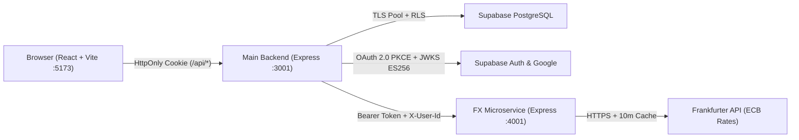

# CuentasClaras (MonkyMoney) — Group Expense Splitting & FX Microservice Ecosystem

Web application and REST microservice ecosystem for managing shared expenses, splitting bills (equally or by exact consumption), converting multi-currency expenses (`USD`, `EUR`, `CAD`, `GBP` → `MXN`) in real time, and simplifying debts among friends.

- **Main Repository (`MonkyMoney`)**: `https://github.com/BeltranDev46/MonkyMoney`
- **FX Microservice Repository (`cuentasclaras-fx-microservice`)**: `https://github.com/BeltranDev46/microservice`
- **Live Frontend (Vercel)**: `https://monkeymoney-eta.vercel.app`
- **Live Main Backend (Render)**: `https://cuentasclaras-backend-u28f.onrender.com`
- **Authentication Architecture Report (Evidence 4)**: [`docs/auth-report.md`](./docs/auth-report.md)

---

## Prerequisites

- **Node.js** `>= 20.0.0` (`node -v`)
- **npm** `>= 10.0.0` (`npm -v`)
- **Git**
- *(Optional for full DB persistence)* A PostgreSQL connection string (`DATABASE_URL`) and Supabase Auth project (`SUPABASE_URL`, `SUPABASE_KEY`). Both services start, pass `/health` checks, and run automated `npm test` suites out of the box using `.env.example`.

---

## How to Install and Run (Step-by-Step)

Follow these exact commands in order on any machine (Windows, macOS, or Linux).

### 1. Install and Start the FX Currency Microservice (`Port 4001`)

Open **Terminal 1**:

```bash
git clone https://github.com/BeltranDev46/microservice.git
cd microservice
npm install
cp .env.example .env
npm run dev
```

*(On Windows PowerShell, use `Copy-Item .env.example .env` instead of `cp`.)*

Verify the microservice started cleanly:

```bash
curl http://localhost:4001/api/v1/health
curl "http://localhost:4001/api/v1/rates?base=USD&symbols=MXN,EUR"
```

Run the microservice's automated test suite (optional):

```bash
npm test
```

---

### 2. Install and Start the Main Backend (`Port 3001`)

Open **Terminal 2**:

```bash
git clone https://github.com/BeltranDev46/MonkyMoney.git
cd MonkyMoney/backend
npm install
cp .env.example .env
```

> **Note on Environment Variables (`backend/.env`)**:
> - By default, `.env.example` already configures `PORT=3001`, `FX_SERVICE_URL="http://localhost:4001/api/v1"`, and the matching `FX_SERVICE_API_KEY` so the backend starts immediately.
> - To enable full user login and PostgreSQL persistence, set `DATABASE_URL` (Supabase Session Pooler IPv4 or Neon PostgreSQL URI), `SUPABASE_URL`, and `SUPABASE_KEY` in `backend/.env`. Tables and RLS policies are initialized automatically on connection (or via `npm run db:init`).

Start the backend server:

```bash
npm run dev
```

Verify the backend is running and run its self-contained authentication tests:

```bash
curl http://localhost:3001/api/health
npm test
```

---

### 3. Install and Start the Frontend SPA (`Port 5173`)

Open **Terminal 3**:

```bash
cd MonkyMoney/frontend
npm install
npm run dev
```

Open **`http://localhost:5173`** in your browser. Vite automatically proxies `/api/*` requests to `http://localhost:3001` with `HttpOnly` session cookies.

---

## System Architecture



---

## REST API Endpoints Summary

### FX Currency Microservice (`http://localhost:4001/api/v1`)

| Method | Endpoint | Auth | Description | Status Codes |
| :--- | :--- | :---: | :--- | :--- |
| `GET` | `/api/v1/health` | Public | Health check and service status. | `200` |
| `POST` | `/api/v1/auth/token` | Public | Issues signed `HS256` Bearer JWT (`expiresIn: 3600`). | `200`, `400`, `401`, `503` |
| `GET` | `/api/v1/currencies` | Public | ISO 4217 currency catalog from Frankfurter API (cached 10 min). | `200`, `502`, `504` |
| `GET` | `/api/v1/rates` | Public | Latest exchange rates (`?base=USD&symbols=MXN,EUR`). | `200`, `400`, `502`, `504` |
| `POST` | `/api/v1/conversions` | `Bearer` | Converts foreign expense to `MXN` with per-person split quote. | `201`, `400`, `401`, `502`, `504` |
| `GET` | `/api/v1/conversions` | `Bearer` | Lists saved conversion quotes for `X-User-Id`. | `200`, `400`, `401` |
| `DELETE` | `/api/v1/conversions/:id` | `Bearer` | Deletes a saved conversion quote by UUID. | `200`, `400`, `401`, `404` |

### Main Backend API (`http://localhost:3001/api`)

| Method | Endpoint | Auth | Description | Status Codes |
| :--- | :--- | :---: | :--- | :--- |
| `GET` | `/api/health` | Public | Server liveness check. | `200` |
| `POST` | `/api/auth/signup` | Public | Email/password account registration. | `201`, `400` |
| `POST` | `/api/auth/login` | Public | Authenticates user and sets `HttpOnly` session cookies. | `200`, `400`, `401` |
| `GET` | `/api/auth/google` | Public | Starts server-side Google OAuth 2.0 PKCE flow. | `302` |
| `GET` | `/api/auth/callback` | Public | Exchanges OAuth PKCE code for `HttpOnly` session cookies. | `302` |
| `POST` | `/api/auth/logout` | Public | Revokes Supabase session and clears `HttpOnly` cookies. | `200` |
| `GET` | `/api/auth/me` | `HttpOnly` Cookie | Returns authenticated user (`ES256` JWKS verified). | `200`, `401` |
| `GET` / `POST` | `/api/groups` | `HttpOnly` Cookie | Lists or creates expense groups owned by `req.user.id`. | `200`, `201`, `400`, `401` |
| `POST` | `/api/groups/:id/expenses` | `HttpOnly` Cookie | Records equal or exact-split expense inside SQL transaction. | `201`, `400`, `401`, `404` |
| `POST` | `/api/groups/:id/settlements` | `HttpOnly` Cookie | Records debt settlement between group members. | `201`, `400`, `401`, `404` |
| `GET` / `POST` / `DELETE` | `/api/fx/*` | `HttpOnly` Cookie | Authenticated BFF proxy to `cuentasclaras-fx-microservice`. | `200`, `201`, `400`, `401`, `503` |

---

## Project Structure

```text
MonkyMoney/
├── backend/
│   ├── sql/schema.sql               # PostgreSQL tables, FK indexes & 16 RLS policies
│   ├── src/
│   │   ├── index.js                 # Express server, CORS, security headers
│   │   ├── db.js                    # PostgreSQL SSL pool & auto-migration
│   │   ├── supabase.js              # Stateless Supabase client & HttpOnly cookie helpers
│   │   ├── middleware/requireAuth.js# ES256 JWKS verification & silent token refresh
│   │   ├── routes/                  # auth.js, groups.js, fx.js
│   │   └── services/fxClient.js     # Authenticated HTTP client to FX microservice
│   ├── tests/auth.test.js           # Self-contained auth integration test suite
│   └── .env.example                 # Documented environment variable template
├── frontend/
│   ├── src/                         # React SPA (LoginPage, ProtectedRoute, DashboardPage, CurrencyConverterBox)
│   └── vercel.json                  # Edge /api/* rewrite to Render + SPA fallback
├── docs/
│   └── auth-report.md               # Evidence 4 Authentication System Report
└── render.yaml                      # Render deployment blueprint
```
